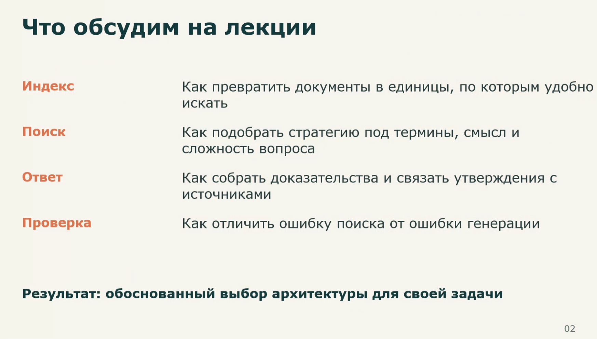
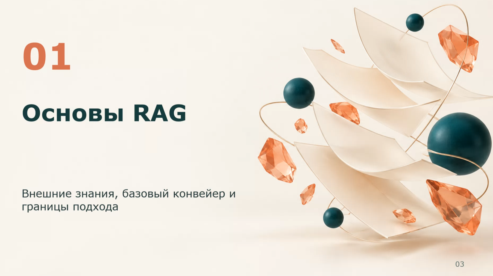
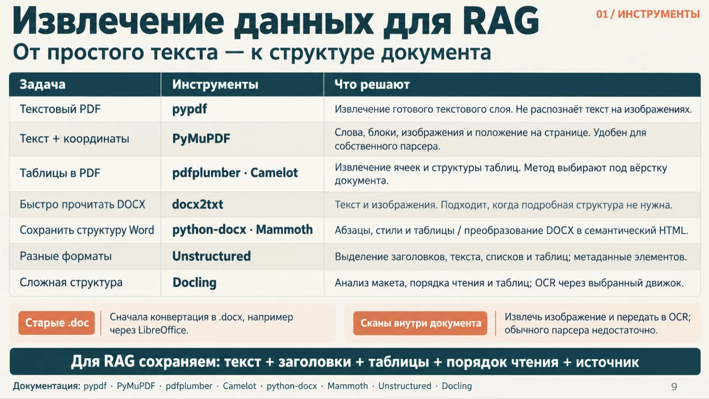
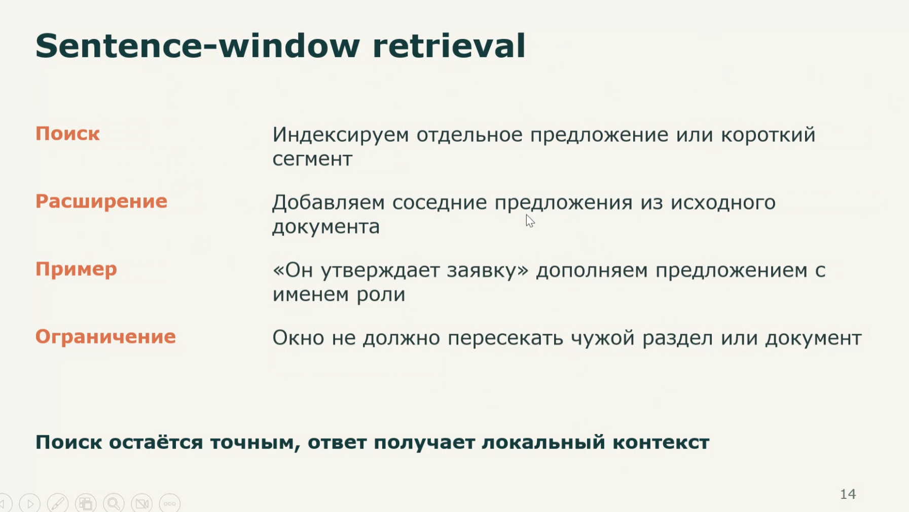
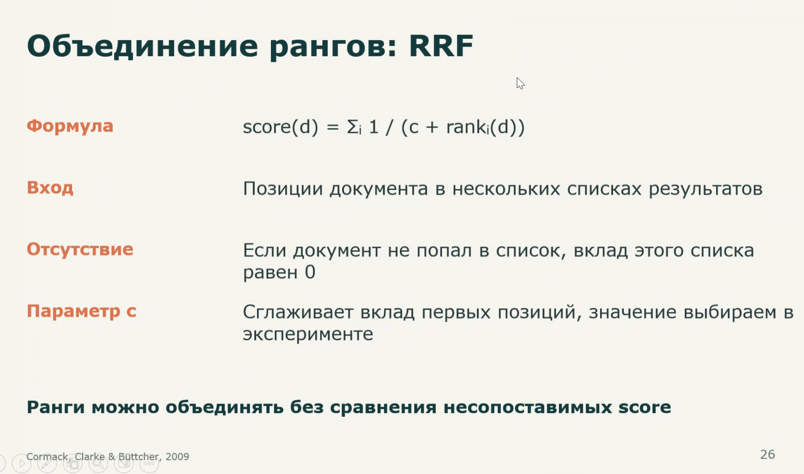
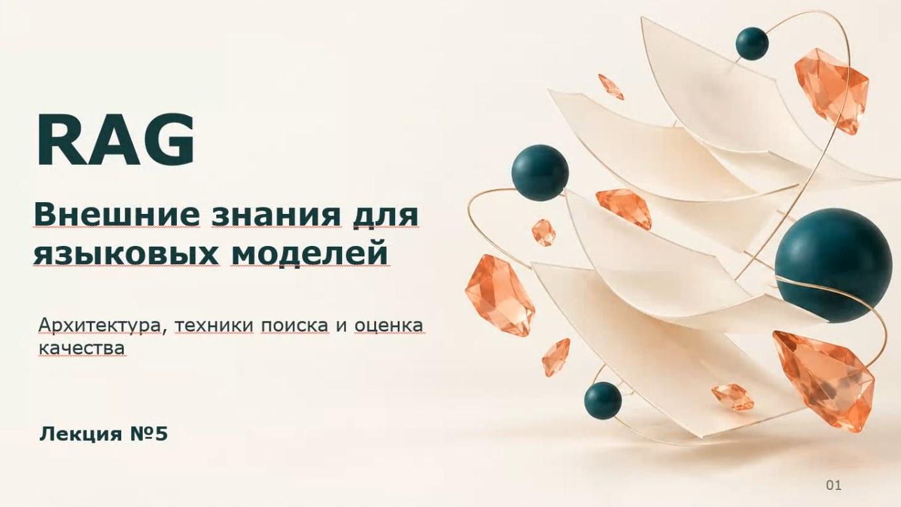

# M1: лекция про RAG — черновик для ручной сверки

Статус: не утверждено пользователем. Все reviewed=false. Это чтение источников агентом, не результат генерации модели и не внешняя проверка утверждений лекции.

Архив: data/private/test_note.zip. SHA256: CCFE337475CAFCFC7A790B75F185934A081FC6FDF528D7D8BB79901A24286B2B.
Заметка: test_note/Лекция 6. RAG. Внешние знания для языковых моделей.md.
Версия каталога: 0.2-rag-draft. Порядок ниже соответствует порядку вставок; лишнее вложение вынесено отдельно.

Для vision-проверки подавать только изображение. Связывание с комментарием проверять отдельно, с явными строками заметки. Не оценивать отсутствующий на слайде текст как пропуск vision-модели. Каждый пункт ниже — кандидат факта, который человеку нужно принять, исправить или исключить; критические пункты отмечены явно. До этого процентные оценки не рассчитывать.

## 1. rag-components — связь с комментарием

Источник: Pasted image 20261010121840.png; вставка в строке 7, комментарий в строке 9.

- Индекс превращает документы в единицы, по которым удобно искать.
- Поиск выбирает стратегию под термины, смысл и сложность вопроса.
- Ответ собирает доказательства и связывает утверждения с источниками.
- Проверка различает ошибку поиска и ошибку генерации.
- Комментарий «система из 4 компонентов» связывается именно с этим слайдом.
- Критическая ошибка: поменять роли компонентов местами или потерять один компонент.

## 2. rag-slide-only — заголовок без комментария

Источник: Pasted image 20261010122123.png; вставка в строке 13, следующая вставка в строке 15. Между ними нет комментария.

- Заголовок раздела: «Основы RAG».
- Подзаголовок: «Внешние знания, базовый конвейер и границы подхода».
- Критическая ошибка: отбросить слайд из-за отсутствия комментария или приписать ему комментарий строк 17–19, относящийся к следующему изображению.
- Это проверка границы раздела; её оценку вести отдельно от полноты содержательных слайдов.

## 3. rag-tables — таблица инструментов

Источник: Pasted image 20261010122829.png; вставка в строке 49, комментарий в строке 51.

Сверить каждую строку таблицы отдельно:

| Задача | Инструменты | Смысл по слайду |
| --- | --- | --- |
| Текстовый PDF | pypdf | Готовый текстовый слой; текст на изображениях не распознаёт |
| Текст + координаты | PyMuPDF | Слова, блоки, изображения, положение на странице; для собственного парсера |
| Таблицы в PDF | pdfplumber · Camelot | Ячейки и структура таблиц; метод зависит от вёрстки |
| Быстро прочитать DOCX | docx2txt | Текст и изображения, если подробная структура не нужна |
| Сохранить структуру Word | python-docx · Mammoth | Абзацы, стили и таблицы / преобразование DOCX в семантический HTML |
| Разные форматы | Unstructured | Заголовки, текст, списки, таблицы и метаданные элементов |
| Сложная структура | Docling | Макет, порядок чтения, таблицы; OCR через выбранный движок |

- Старый .doc сначала конвертируется в .docx; пример на слайде — LibreOffice.
- Скан внутри документа требует извлечения изображения и OCR; обычного парсера недостаточно.
- Для RAG сохраняются текст, заголовки, таблицы, порядок чтения и источник.
- Комментарий предупреждает о потере структуры таблиц.
- Критические ошибки: смешение строк/столбцов, приписывание pypdf распознавания сканов, потеря отрицания про OCR.
- Перед количественной оценкой разбить составные ячейки на отдельные проверяемые факты и отметить критические.

## 4. rag-sentence-window — числовое уточнение из заметки

Источник: Pasted image 20261010124526.png; вставка в строке 84, комментарий в строках 86–89.

- Индексируется отдельное предложение или короткий сегмент.
- Для расширения добавляются соседние предложения из исходного документа.
- Пример на слайде: «Он утверждает заявку» дополняется предложением с именем роли.
- Критическое ограничение: окно не пересекает чужой раздел или документ.
- Только в заметке есть пример размера окна: «+ 2 предложения туда и сюда»; на изображении этого числа нет.
- Критическая ошибка: объявить ±2 универсальным требованием алгоритма или требовать это число при оценке только изображения.

## 5. rag-rank-fusion — точность формулы

Источник: Pasted image 20261010131852.png; вставка в строке 180, комментарий в строках 182–183.

- Формула: `score(d) = Σ_i 1 / (c + rank_i(d))`; допускается эквивалентная математическая запись.
- Вход — позиции документа в нескольких списках результатов.
- Если документ не попал в список, вклад этого списка равен 0.
- Параметр c сглаживает вклад первых позиций.
- Значение c выбирается в эксперименте; конкретное число на слайде не задано.
- Ранги объединяются без сравнения несопоставимых score; комментарий подчёркивает использование позиций вместо scores.
- Критические ошибки: потерять сумму, изменить знаменатель или индексы, придумать фиксированное c, дать ненулевой вклад отсутствующему документу.

## 6. rag-orphan-attachment — лишнее вложение

Источник: Pasted image 20261010121650.png. По inspect отсутствует среди wiki-вставок.

- Выдать предупреждение о неиспользуемом вложении.
- Не включать изображение автоматически в последовательность лекции и не отправлять его модели в обычном пайплайне.
- На обложке указана «Лекция №5», тогда как имя заметки содержит «Лекция 6». Это наблюдаемое расхождение, а не основание переименовать источник или исправить его содержание.
- Сценарий проверяет импорт; не включать его в среднюю полноту vision-извлечения.

## Следующий шаг

Сверить изображения и критерии человеком; уточнить атомарные факты и критические ошибки. Затем зафиксировать утверждённый набор и отдельно реализовать эксперимент. Наличие 4B в Ollama не подтверждает качество; 8B сейчас отсутствует. Никакие результаты baseline не получены.
